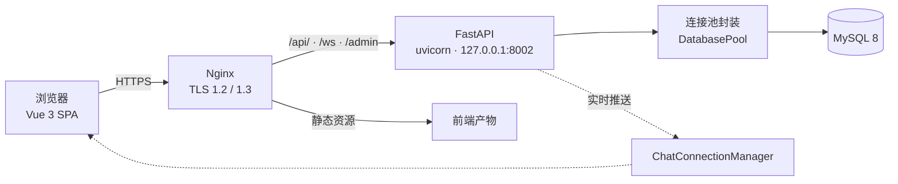

# 湛对网 · Zhan Dui Wang

> 校园社交与即时通讯应用。资料匹配、好友关系、动态广场、实时私聊，配套后台管理，已部署上线。

**FastAPI** · **SQLAlchemy** · **MySQL 8** · **Alembic** · **WebSocket** · **Vue 3 + Vite** · **Nginx** · **systemd**

线上环境：`zhanduiwang.top`

---

## 项目概览

| 项 | 数值 |
| --- | --- |
| 后端 | 约 2,100 行 Python（FastAPI，单服务 49 个接口） |
| 前端 | 约 4,500 行（Vue 3 SPA，15 个页面） |
| 数据库迁移 | 2 个 Alembic 迁移，均带 `downgrade` |
| 自动化测试 | 21 个用例，覆盖安全、数据库连接池、WebSocket |
| 部署 | Nginx + systemd（原生部署，非容器） |

> 📷 **截图占位**：首页/星球、资料匹配、动态广场、私聊界面、后台管理台
> *（面试前请补上 3~5 张真实截图，评审最先看这部分）*

## 功能一览

| 模块 | 能力 |
| --- | --- |
| **账号** | 手机号登录、注册、JWT 鉴权、资料与头像/背景图上传 |
| **匹配** | 按资料与兴趣推荐、用户搜索与列表、星球展示开关 |
| **好友** | 好友申请、同意/拒绝、删除、好友列表 |
| **动态** | 发帖、图片、点赞、评论、广场信息流 |
| **私聊** | WebSocket 实时消息、图片消息、已读回执、会话列表 |
| **后台** | 用户管理、帖子管理、会话与消息审计、统计概览 |
| **运维** | 健康检查、就绪检查（探测数据库）、公开统计 |

---

## 技术架构



**请求链**：Nginx → 认证中间件（JWT + 越权校验 + 请求 ID + 审计日志）→ 路由 → 连接池 → MySQL。

---

## 技术难点与设计决策

### 1️⃣ 消息幂等：让 WebSocket 重发和 REST 兜底不产生重复

即时通讯的经典问题：**客户端发消息后没收到确认，于是重发；但服务端可能已经存过了。**

项目给每条消息引入客户端生成的 `client_id`，并在数据库上建立唯一约束：

```sql
ALTER TABLE messages
    ADD CONSTRAINT uq_messages_sender_client UNIQUE (sender_id, client_id);
```

写入逻辑（`persist_message`）不靠"先查再写"（有并发竞态），而是**直接尝试插入，撞唯一约束后回滚并取回已存在的记录**：

```python
try:
    c.execute("INSERT INTO messages (...) VALUES (...)", (...))
    c.connection.commit()
except IntegrityError:                 # 唯一约束冲突 = 这条消息已经存过
    c.connection.rollback()
    existing = find_message_by_client_id(sender_id, client_id)
    if existing:
        return existing                # 返回原记录，客户端看到同一条消息
    raise
```

**效果**：无论客户端重发几次，数据库里永远只有一条，接口返回同一个 `id`。幂等性由**数据库约束**保证，而不是应用层判断。

### 2️⃣ 用数据迁移做数据清理 + 约束加固

`001_harden_relational_integrity` 一个迁移里同时完成了三件事：**清理脏数据 → 建约束 → 加索引**。

**清理重复好友关系**（历史数据里可能存在 A↔B 和 B↔A 两条），用窗口函数去重，并优先保留状态更靠前的记录：

```sql
ROW_NUMBER() OVER (
    PARTITION BY LEAST(user_id, friend_id), GREATEST(user_id, friend_id)
    ORDER BY CASE status WHEN 'ACCEPTED' THEN 0 WHEN 'PENDING' THEN 1 ELSE 2 END, id DESC
)
```

**用函数索引从根上杜绝重复**——保证 (A,B) 与 (B,A) 只能存在一条：

```sql
CREATE UNIQUE INDEX uq_friendships_pair
ON friendships ((LEAST(user_id, friend_id)), (GREATEST(user_id, friend_id)));
```

**其他加固**：`CHECK (user_id <> friend_id)` 禁止加自己为好友；5 个外键均带 `ON DELETE CASCADE`；按查询模式新建 9 个组合索引（如 `messages(sender_id, receiver_id, create_time, id)` 支撑会话消息分页）。

整个迁移有完整的 `downgrade()`，可安全回滚。

### 3️⃣ 越权防护（IDOR）在中间件统一拦截

很多接口把用户 ID 放在 URL 或查询参数里（`/api/users/{uid}/profile`、`?userId=`）。**如果只校验"有没有登录"，攻击者改一个 ID 就能操作别人的数据。**

项目在全局中间件里统一校验：**请求声称的 `userId` / `senderId` 必须与 JWT 中的身份一致**，否则 403。

```python
for key in ("userId", "senderId"):
    claimed = request.query_params.get(key)
    if claimed is not None and int(claimed) != request.state.user_id:
        response = JSONResponse({"detail": "Forbidden"}, status_code=403)
```

这条路有专门测试覆盖，**从三个入口分别验证**无法伪造身份：

```
test_query_user_id_cannot_be_spoofed        # 查询参数
test_path_user_id_cannot_be_spoofed         # 路径参数
test_multipart_sender_id_cannot_be_spoofed  # 表单字段
```

### 4️⃣ 连接池封装：游标生命周期不出错

直接用原始连接容易漏关游标、连接泄漏。项目封了一层 `PooledConnection` / `PooledCursor`：

- 记住这条连接开过的**所有游标**，`close()` 时一次性收尾
- 线程锁保护，重复 `close()` 不会重复关闭底层连接
- 支持 `with` 语法，**异常时自动 rollback**，无论如何都会 close

```python
def __exit__(self, exc_type, _exc, _traceback):
    try:
        if exc_type is not None:
            self.rollback()
    finally:
        self.close()
```

底层 `create_engine` 配置了 `pool_pre_ping=True`（连接失效自动探活）、`pool_recycle`（防止 MySQL 空闲超时断连）、`pool_size` / `max_overflow` / `pool_timeout` 全部走环境变量。这部分有单元测试，用 Fake 连接验证"只关闭一次"和"异常时回滚"。

### 5️⃣ WebSocket 连接管理与死连接清理

`ChatConnectionManager` 支持同一用户多端在线（默认上限 5 条连接，超限用 `4429` 关闭）：

```python
class ChatConnectionManager:
    connections = defaultdict(set)          # user_id -> {websocket, ...}
    max_connections_per_user = 5
```

推送时**遍历所有在线连接，发送失败的自动从集合中摘除**——避免死连接堆积导致内存泄漏和无效推送。

### 6️⃣ 生产部署加固

**systemd 单元**启用了完整的沙箱保护：

```
User=zhandui                    # 非 root 运行
ProtectSystem=strict            # 文件系统只读，仅白名单可写
ProtectHome=true                # 看不到家目录
ProtectKernelTunables/Modules/Logs=true
Restart=always / RestartSec=5s
```

**Nginx** 只暴露必要入口，`/api/`、`/ws`、`/admin` 反向代理到本机 `8002`，启用 TLS 1.2/1.3，`client_max_body_size 5m` 与后端上传限制对齐。

**密钥不进代码**：`EnvironmentFile=/etc/zhandui/zhandui.env`，仓库内只保留 `.env.example`。必填项缺失时服务**启动即失败**（`required_env()` 直接抛异常），不会带着空密钥跑起来。

---

## 工程实践

| 实践 | 说明 |
| --- | --- |
| **结构化日志** | JSON 格式日志，每条带 `request_id` / `client_ip` / `duration_ms` |
| **请求链路追踪** | 中间件生成或透传 `X-Request-ID`，响应头回写 |
| **审计日志** | 后台登录成功/失败、删除用户等敏感操作全部留痕（有测试覆盖） |
| **限流** | 滑动窗口限流，超限返回 429 |
| **上传安全** | 图片类型**按文件内容判断**，不信扩展名；非图片直接拒绝 |
| **健康检查** | `/api/health`（存活）与 `/api/health/ready`（探测数据库）分离 |
| **线上基线留存** | `ops/live-baseline/` 保存生产环境实际配置，便于比对 |
| **备份脚本** | 独立凭据文件（不与应用共用密码）· `--single-transaction` 一致快照 · 备份后校验压缩包完整性与大小 · 生成 SHA-256 · 自动保留 14 天 · `set -Eeuo pipefail` + `umask 077` |

测试通过 `scripts/test.ps1` 一键运行：

```
python -m compileall backend     # 语法检查
python -m pytest                 # 单元与安全测试
alembic upgrade head --sql       # 迁移可生成校验
npm audit --omit=dev             # 前端依赖审计
npm run build                    # 前端生产构建
```

## 目录结构

```text
backend/
  api_service.py      服务主文件：中间件、路由、WebSocket、消息持久化
  database.py         连接池封装（PooledConnection / DatabasePool）
  migrations/         Alembic 迁移
frontend/              Vue 3 SPA（15 个页面）
ops/                   生产部署资源
  nginx-zhandui.conf      Nginx 站点配置（TLS + 反向代理）
  zhandui-api.service     systemd 单元（沙箱加固）
  zhandui-security.conf   额外安全配置
  backup.sh               数据库备份脚本
  live-baseline/          线上环境基线配置
tests/                 安全与数据库测试
scripts/test.ps1       一键验证脚本
```

## 快速开始

**环境要求**：Python 3.13+ · Node.js 20+ · MySQL 8

后端（在仓库根目录执行）：

```powershell
python -m venv .venv
.\.venv\Scripts\python.exe -m pip install -r backend\requirements.txt

# 配置环境变量，参考 backend\.env.example
# DB_USER / DB_PASSWORD / DB_NAME / JWT_SECRET / ADMIN_USER / ADMIN_PASSWORD 为必填

.\.venv\Scripts\python.exe -m alembic -c alembic.ini upgrade head   # 建表与迁移
.\.venv\Scripts\python.exe backend\api_service.py                   # 默认 8002
```

前端：

```powershell
Set-Location frontend
npm ci
npm run dev        # Vite 开发服务器
npm run build      # 生产构建
```

验证：

```powershell
.\scripts\test.ps1
```

## 接口概览

| 分组 | 路径 |
| --- | --- |
| 健康与统计 | `/api/health` · `/api/health/ready` · `/api/public/stats` · `/api/stats/overview` |
| 账号 | `/api/auth/login` · `/api/auth/register` · `/api/users/*` |
| 匹配与好友 | `/api/users/recommend` · `/api/users/search` · `/api/friends/*` |
| 动态 | `/api/posts/*` · `/api/posts/{id}/like` · `/api/posts/{id}/comment` |
| 私聊 | `WS /ws` · `/api/conversations` |
| 后台 | `/api/admin/*` · `/admin` |

除公开路径外，所有 `/api/` 请求都需要 `Authorization: Bearer <token>`。

## 部署

原生部署（Nginx + systemd）：

```bash
# 1. 发布到 /opt/zhandui/releases/<release>
# 2. 激活软链，执行迁移
cd /opt/zhandui/releases/<release>
set -a; . /etc/zhandui/migration.env; set +a
/opt/zhandui/venv/bin/python3 -m alembic -c alembic.ini current
/opt/zhandui/venv/bin/python3 -m alembic -c alembic.ini upgrade head

# 3. 升级前先备份并校验
/opt/zhandui/backup.sh
```

生产密钥存放于 `/etc/zhandui/zhandui.env`（服务运行用）与 `/etc/zhandui/migration.env`（迁移专用 DDL 账号），**均不入库**。

## 配置与安全

| 变量 | 说明 |
| --- | --- |
| `DB_USER` / `DB_PASSWORD` / `DB_NAME` | 数据库凭据（**必填**，缺失即启动失败） |
| `JWT_SECRET` | 签名密钥（**必填**，至少 32 随机字节） |
| `ADMIN_USER` / `ADMIN_PASSWORD` | 后台账号（**必填**） |
| `UPLOAD_ROOT` / `MAX_IMAGE_BYTES` | 上传目录与单文件上限 |
| `DB_POOL_*` | 连接池参数 |
| `WS_MAX_CONNECTIONS_PER_USER` | 单用户 WebSocket 连接上限（默认 5） |

- 仓库内**不含任何凭据**，`.env` 已被忽略
- 应用以非 root 用户 `zhandui` 运行，systemd 启用文件系统与内核保护
- 上传图片按内容校验类型，并限制大小
